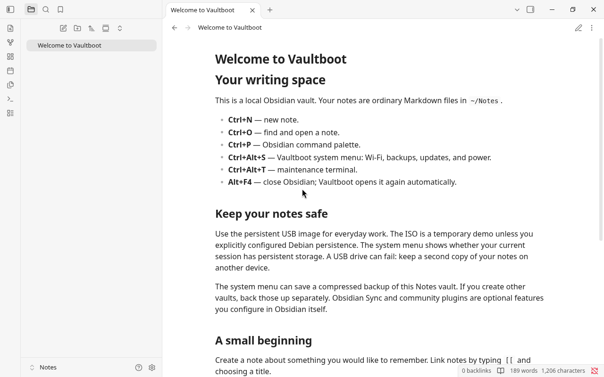

# Vaultboot

**Turn a PC into a dedicated Obsidian notebook.**

Vaultboot is a small Debian 13 system that signs in automatically and opens
Obsidian. There is no desktop panel, app launcher, office suite, or web browser.
Debian handles the hardware, networking, sound, and storage underneath.

This is an independent community project, not an official Obsidian product.
Obsidian itself is downloaded from its official releases during first setup;
it is not redistributed in our images. After setup, your app, settings, and
notes stay on the USB drive, microSD card, or installed computer and work offline.



Actual preview image running in a PC virtual machine after setup.

**Early preview:** see the release's test report for what has actually been
tested. Compatibility with your particular PC is not guaranteed.

## Download and boot

### Automatic USB flashing

On Linux or macOS with Python 3 installed, download this repository and run:

```sh
git clone https://github.com/Emmanuelcsam/vaultboot.git
cd vaultboot
./autoflash.sh
```

The guided flasher downloads a release, verifies its checksum, shows eligible
USB drives, asks you to confirm the exact drive to erase, writes it, and verifies
the written bytes. Choose the **target computer's** architecture: Intel/AMD PC
or Raspberry Pi 3. The computer creating the USB does not need the same architecture.
See [flashing instructions](docs/flashing.md) for prerequisites, options, and Windows.

### Manual download

Choose the image for your device:

| Device | Download | Storage |
| --- | --- | --- |
| 64-bit Intel/AMD PC | [PC USB image](https://github.com/Emmanuelcsam/vaultboot/releases/download/v0.1.0-preview.2/vaultboot-0.1.0-preview.2-amd64.img.gz) | 8 GB or larger USB |
| Raspberry Pi 3B / 3B+ | [Experimental Pi image](https://github.com/Emmanuelcsam/vaultboot/releases/download/v0.1.0-preview.2/vaultboot-0.1.0-preview.2-pi3-arm64.img.gz) | 16 GB or larger microSD |

Get `SHA256SUMS` and the test report from the [release page](https://github.com/Emmanuelcsam/vaultboot/releases/tag/v0.1.0-preview.2).
Physical hardware has not been validated. The Pi image is experimental.

These steps are for the **Intel/AMD PC image**. Raspberry Pi needs a separate
ARM64 image. Check the [hardware guide](docs/hardware.md) first.

1. Open [Releases](https://github.com/Emmanuelcsam/vaultboot/releases) and download
   the **`vaultboot-…-amd64.img.gz`** file and `SHA256SUMS`. The source archives are for developers;
   you do not need them to use the system.
2. Verify the download against `SHA256SUMS`, then extract the `.gz` file to get
   the `.img`. The raw image is about 4.7 GiB; allow at least 8 GiB free space
   for extraction.
3. Use an image writer such as [Raspberry Pi Imager](https://www.raspberrypi.com/software/)
   (choose a custom image) or [balenaEtcher](https://etcher.balena.io/) to write the
   `.img` to an **8 GB or larger USB drive**. Check the selected drive carefully:
   flashing erases that drive.
4. Boot the PC from USB using its firmware boot menu. Turn off Secure Boot for
   this preview. Both legacy BIOS and 64-bit UEFI boot are supported by the image.
5. Connect to the internet for the one-time Obsidian download. Ethernet normally
   connects automatically; the setup screen can open Wi-Fi settings.
6. Open your notebook. Subsequent boots go straight into Obsidian.

The USB image includes a writable partition for notes and settings. It boots
without installing to or erasing the PC's internal drive. Leave the USB plugged
in while using it. Use the system menu to shut down before removing it.
If Windows or macOS offers to format or initialize the USB after flashing,
cancel: its Linux storage is intentional.

### Install onto a PC

Boot the USB on the destination PC first. Press **Ctrl+Alt+S**, choose
**Install to internal drive**, and follow the drive-selection prompts.
Installation erases the entire selected drive, including its existing operating
system. The installer creates a fresh Debian installation that can boot on its
own after you shut down and remove the USB. It works offline from the USB;
first Obsidian setup still needs internet.

Your USB's notes are kept on the USB and are not automatically copied to the new
installation. Back them up and restore them when ready. The PC installer is
separate from the Pi's microSD flashing process. See [installation instructions](docs/installing.md).

The preview starts with a US English keyboard layout. For another layout,
follow [first-run settings](docs/maintenance.md#first-run-settings) before
entering a Wi-Fi password. That section also explains the keyboard controls
in the network setup screen.

The separate **`.iso` is a temporary demo / VM image**. Without a persistence
volume, changes disappear at shutdown; the setup screen warns about this.
Choose the USB image for everyday use.

### Raspberry Pi

Extract the separate **`pi3-arm64.img.gz`**, then write its `.img` to a
**16 GB or larger microSD card** using a custom-image option in your image writer.
Flashing erases that card. Insert it into a Pi 3B or 3B+, connect a display,
keyboard, mouse, network, and suitable power supply, then boot. First setup
downloads Obsidian; later boots use the installed copy. Notes and settings live
on the writable microSD filesystem.

This preview needs physical Pi testing. Its 1 GB RAM is a serious constraint;
start with a small vault and no community plugins. It is not an image for
arbitrary ARM devices.

## Hardware

- The current PC image targets **64-bit Intel or AMD PCs** with USB boot.
  Some old 64-bit machines have 32-bit UEFI and are unsupported.
- **4 GB RAM recommended** as a project starting point, not an official Obsidian
  minimum. Plugin count, graph size, attachments, and vault size affect memory.
- An 8 GB or larger USB drive; a USB SSD is preferable for sustained use.
- Common Intel/AMD graphics and common Wi-Fi firmware are included. Unusual
  hardware may need extra drivers. Ethernet is the simplest setup connection.

A separate **experimental Raspberry Pi 3 ARM64 image** is provided; its 1 GB
memory makes it a constrained target. The PC image does not
run on a Pi. See the [compatibility matrix](docs/hardware.md) for architecture,
memory, and boot limits.

Obsidian still contains Electron. Removing a desktop reduces background work,
but does not remove Obsidian's own CPU and memory needs. No benchmark against
your old operating system is claimed.

## Everyday controls

| Shortcut | Action |
| --- | --- |
| `Ctrl+Alt+S` | Wi-Fi, files/drives, sound, display, keyboard, time zone, backups, updates, installation, and power |
| `Ctrl+Alt+T` | Maintenance terminal |
| `Ctrl+Alt+F` | Files and attached drives |

Your default vault is `~/Notes`. Plugins and themes work through Obsidian as
usual; none are preinstalled. The system reopens Obsidian if it exits, with
failure recovery rather than an endless fast restart loop.

To connect Wi-Fi, choose **Wi-Fi / Ethernet** in the system menu (or the network
option during first setup), select the network, and enter its password. Use
arrow keys, Tab, and Enter in the connection screen. Saved connections reconnect
automatically and survive reboot on persistent media. Ethernet normally connects
automatically. Common Wi-Fi firmware is included; hardware-specific support varies.

There is intentionally no browser. Web links, browser-only login flows, and
plugins requiring external applications may not work. Obsidian Sync is optional
and subject to its own account/subscription terms. Do not depend on it as your
only backup.

## Keep your notes safe

This is a personal appliance with automatic sign-in, **not a locked public kiosk**.
Someone with physical access can read its unencrypted USB or microSD data and use its
maintenance tools. The live account is `writer`, password `live`, with local sudo
access. No SSH server is installed. Change the password with `passwd` if desired;
automatic graphical sign-in remains enabled.

Back up `~/Notes` and any other vaults to another drive or backup service. A
bootable USB is not a backup. The PC image includes a fixed 4 GiB writable
partition in addition to the base OS. The Pi image has an 8 GiB filesystem layout
shared by the OS, application, and notes. Larger media do not automatically
enlarge these filesystems. See
[storage and maintenance](docs/maintenance.md) for capacity and upgrades.

**Reflashing destroys that USB drive or microSD card's notes and settings.** Back them up first.

## Build and contribute

The project uses Debian's `live-build`, ordinary shell/Python, Xorg, Openbox,
and LightDM. There is no custom kernel, Arch base, proprietary plugin bundle,
or remote server dependency after setup.

```sh
python3 -m unittest discover -s tests -v
# Linux x86-64 host with Docker, enough disk space, and permission to use Docker:
VAULTBOOT_VERSION=0.1.0-preview.2 ./scripts/build.sh ./artifacts
```

Building uses a privileged Docker container to construct a Debian chroot.
Use a trusted disposable build machine; do not give this permission to
untrusted pull requests. Runtime processes do not run in that container.
See [architecture](docs/architecture.md) and [release procedure](docs/releasing.md).
The separate ARM64 image has its own [Raspberry Pi build instructions](docs/building-pi.md).

Original project code is MIT licensed. Third-party packages keep their own
licenses. Every binary release must include its corresponding Debian sources,
package manifest, and checksums; see [licensing](docs/licensing.md).
